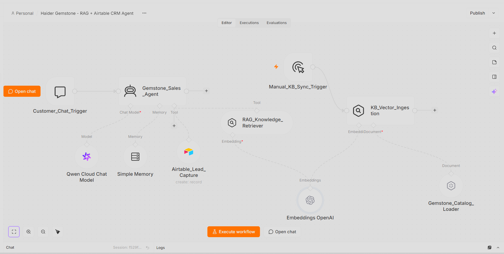
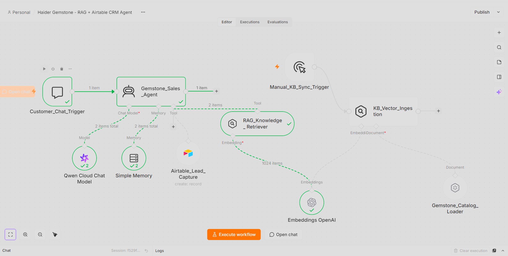
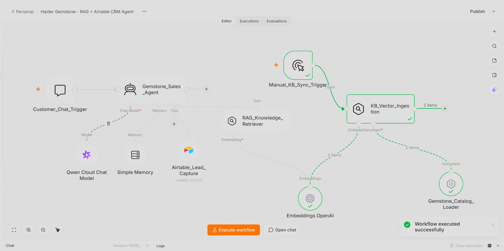

# 💎 Enterprise RAG + Airtable CRM Sales Agent

An autonomous, Retrieval-Augmented Generation (RAG) sales and customer support assistant orchestrated in **n8n**. Built for **Haider Gemstone**, this AI agent combines a custom vector knowledge base with live **Airtable CRM** lead capture. It answers customer queries regarding gemstone varieties, pricing, certification, and exchange policies in natural Roman Urdu/English, while automatically extracting buyer details and logging qualified leads into Airtable—all running securely on a **self-hosted Docker infrastructure on a local server**.

---

## 🌟 Executive Summary
E-commerce and custom retail businesses lose high-intent buyers when inquiries go unanswered or product details are inconsistent. This workflow solves both challenges by pairing an AI conversational agent with a verified internal knowledge base. Customers receive instant, accurate answers backed by vector search, and whenever a buyer expresses purchase intent, the agent extracts their contact info, city, and stone requirements to create a structured CRM record automatically. All operations run locally via Docker for complete data privacy.

---

## 🖼️ System Architecture & Execution Proofs

### 1. Core n8n Workflow Architecture
*The complete dual-pipeline orchestration canvas showing the Customer Chat Agent, RAG Retriever, Airtable CRM Tool, and Knowledge Base Vector Ingestion flow:*

### 2. Live Chat & RAG Retrieval Execution
*Successful execution showing the conversational agent querying the vector store and generating context-aware responses with conversation memory:*

### 3. Knowledge Base Vector Ingestion Execution
*Successful execution of the knowledge sync pipeline loading catalog data, generating vector embeddings, and upserting into the vector store:*

---

## ⚙️ Core Tech Stack & AI Models

### 1. Infrastructure & Orchestration
- **Engine:** n8n (Self-Hosted via Docker Desktop on Local Server Environment)
- **Triggers:** 
  - `Customer_Chat_Trigger` for real-time conversational customer support.
  - `Manual_KB_Sync_Trigger` for on-demand catalog and policy updates.

### 2. AI Intelligence, Memory & RAG Layer
- **Reasoning LLM:** High-speed Qwen LLM (`qwen/qwen3.8-27b` via Groq / Qwen Cloud) configured as a LangChain ReAct Sales Agent.
- **Conversation Memory:** Window Buffer Memory (`Simple Memory`) maintaining multi-turn chat context per customer session.
- **Vector Store & Embeddings:** In-Memory Vector Store (`vector_store_key`) powered by Google Gemini / OpenAI text embeddings for semantic catalog retrieval.

### 3. CRM & Action Layer
- **Lead Capture Tool:** Airtable CRM (`Airtable_Lead_Capture`) utilizing dynamic `$fromAI()` parameter extraction to log Customer Name, Phone Number, City, Stone Required, Deal Stage, and Notes.

---

## 🚀 The Automated Pipeline Flow

1. **Knowledge Base Ingestion:** Running the manual sync trigger loads the structured markdown catalog (shop location, gemstone pricing tiers, 925 silver ring rules, and 7-day exchange policies), generates dense embeddings, and stores them in the vector database.
2. **Customer Inquiry Ingestion:** Inbound customer messages trigger the `Gemstone_Sales_Agent` with active session memory.
3. **Semantic RAG Lookup:** When asked about pricing, origins, or policies, the agent queries `RAG_Knowledge_Retriever` to prevent hallucinations and provide verified answers.
4. **Automated CRM Lead Capture:** When a customer shares order details or contact information, the agent invokes `Airtable_Lead_Capture` to create a structured lead entry under the `Inquiry` deal stage.

---

## 👨‍💻 Engineering Highlights & Problem Solving

- **Secure Dockerized Local Deployment:** Fully self-hosted on a local Docker container, ensuring proprietary pricing guides, customer phone numbers, and CRM credentials remain strictly private.
- **Zero-Hallucination Guardrails:** Enforced strict system instructions requiring the agent to rely exclusively on retrieved vector knowledge and escalate out-of-catalog requests (such as diamonds) directly to WhatsApp support.
- **Autonomous Parameter Extraction:** Leveraged n8n's `$fromAI()` expressions inside the Airtable tool node so the agent seamlessly parses unstructured chat messages into clean, structured database columns.

---
*Architected and Developed by **Abu Bakar Siddique** (@hafiz-abubakar-dev) — AI Automation Engineer*
